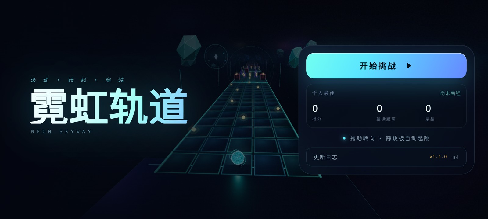
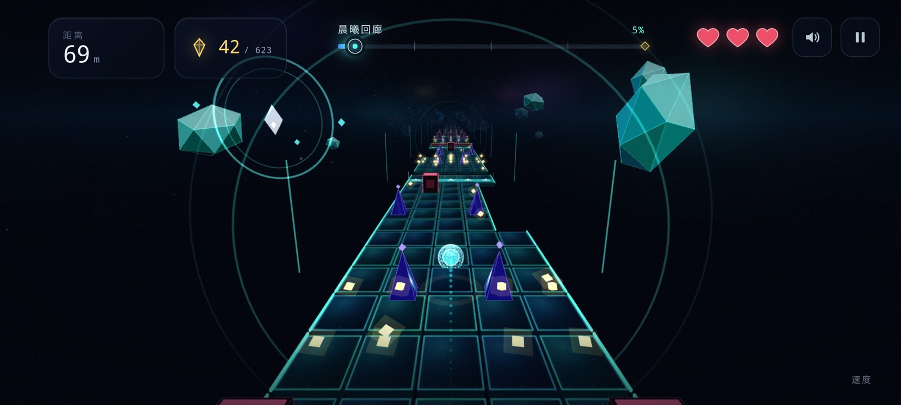

# 霓虹轨道 · Neon Skyway

一款《滚动的天空》风格的 3D 霓虹滚球游戏。这是可在 Android 手机本地离线运行的版本。

- **安装包**：[`dist/NeonSkyway-v1.1.0.apk`](dist/NeonSkyway-v1.1.0.apk)
- **系统要求**：Android 7.0（API 24）及以上，横屏
- **网络**：完全离线，不需要网络权限
- **包名**：`com.neonskyway.game`　**版本**：1.1.0（versionCode 2）



## 安装

1. 把 `dist/NeonSkyway-v1.1.0.apk` 传到手机（微信/QQ 文件传输、数据线、网盘均可）。
2. 在手机的文件管理器里点开 APK。
3. 如果系统提示“未知来源”，按提示允许当前文件管理器或浏览器安装即可；部分手机会有 Play Protect 扫描提示，选择“仍要安装”。
4. 安装后桌面会出现「霓虹轨道」图标，点开即玩；全程无需联网。

APK 使用本地自签名证书。若以后换签名重新打包，需要先卸载旧版再安装。

SHA-256：`f53f07afd3030831b098006b579339275fe8879f63e50132c33350fbe696e108`

## 玩法

- **拖动 / 滑动屏幕**：左右转向
- **不再需要手动跳跃**：踩上发光跳板会自动起跳，跳板是唯一的起跳方式
- 右上角 **暂停**，可继续、重开或返回主页
- **Android 返回键**：游戏中暂停；暂停/结算时回主页；主页再按退出
- 收集星晶加分；踩跳板时收集空中星晶弧，分数更高
- 共 3 颗星核，坠落或撞上障碍会损失 1 颗
- 300 / 600 / 900 米检查点会回满星核
- 终点 1200 米，沿途 6 个主题区



## 1.1.0「节奏革命」

- **跳板即节拍**：移动端只保留拖动转向；手动跳跃已移除。
- **固定节奏谱**：120 BPM、恒定 12 m/s，每拍 6 米；25 块宽跳板全部落在拍点上。
- **新场景与障碍**：六个区域各有签名地标；新增旋转棱镜、镜面板、陨石、光环和漂移平台。
- **原创电音**：120 BPM 合成器编曲，踩板瞬间 trigger impact，提前一拍 riser。
- **更新日志**：首次打开或升级后自动展示。

完整更新记录见 [CHANGELOG.md](CHANGELOG.md)。

## 功能

- 全 3D 霓虹轨道、6 个主题区、动态天空与星海背景
- 确定性节奏关卡：宽跳板、低墙、缺口、星晶弧与可躲避障碍
- 拖尾、护盾、粒子、屏幕震动、检查点、结算与最高分
- WebAudio 合成背景音乐与音效，可一键静音
- 沉浸式全屏、常亮、横屏锁定；切到后台自动暂停
- 触屏 UI 适配，短横屏下结算/暂停/更新日志面板不会超出屏幕

## 项目结构

```
rolling-sky-plus-mobile/
├── android/app/src/main/
│   ├── AndroidManifest.xml
│   ├── java/com/neonskyway/game/MainActivity.java
│   ├── res/                       # 图标、启动页、主题
│   └── assets/game/               # 离线游戏本体（HTML/CSS/JS/Three.js）
├── design/make_icon.py            # 生成各密度桌面图标
├── keystore/neonskyway.jks        # 本地更新用签名（.gitignore 排除，不提交）
├── build.sh                       # 无 Gradle 的手动构建脚本
├── dist/NeonSkyway-v1.1.0.apk     # 成品
├── web/                           # 网页版源码（与 Android assets 同源）
├── CHANGELOG.md
└── dist/preview/                  # 截图
```

Android 侧使用的是 `android/app/src/main/assets/game/` 下的副本；如果改了 `web/` 里的网页版，需要把 `index.html`、`css/`、`js/`、`vendor/` 重新复制过去。

## 从源码构建

需要 JDK 17（`javac` / `keytool`）、`zip`，以及 Android SDK 的 `platforms/android-34` 和 `build-tools/34.0.0`。

如果本地有 `.toolchain/android-sdk/`，`build.sh` 会直接使用；否则指定 Android SDK 34：

```bash
cd rolling-sky-plus-mobile
ANDROID_SDK_ROOT="$HOME/Library/Android/sdk" ./build.sh
```

脚本会完成 aapt2 资源编译、javac、d8、zipalign 和 apksigner 签名，输出 `dist/NeonSkyway-v1.1.0.apk`。工具链（`.toolchain/`）、模拟器（`.emulator/`）和签名密钥不会提交到仓库。

签名密钥默认参数：

- keystore：`keystore/neonskyway.jks`
- alias：`neonskyway`
- store/key password：`neonskyway-local`

可通过 `ANDROID_SDK_ROOT`、`KEYSTORE_PASSWORD`、`KEY_PASSWORD` 覆盖。这个 keystore 只用于本地安装和更新，不适合发布到应用商店。

## 测试情况

已在 Android 14（API 34）arm64 模拟器、2400×1080 横屏完成安装与冒烟测试：菜单、更新日志、倒计时、游玩、转向、踩板自动起跳、星晶、障碍碰撞、暂停、返回键、切后台恢复、结算布局、重开/回主页均正常。模拟器使用软件渲染（SwiftShader）约 4 fps，因此帧率不代表真机表现；真机使用 GPU 渲染。

## 已知说明

- 游戏固定横屏，竖屏下不会旋转布局。
- 首次安装启动时，Android 可能显示一次系统的全屏手势提示，点“Got it”即可。
- 无网络权限、无广告、无统计上报。

## 参考

- 音乐与音效：WebAudio 实时合成（无外部音频文件）
- 3D 引擎：Three.js r152（MIT）
