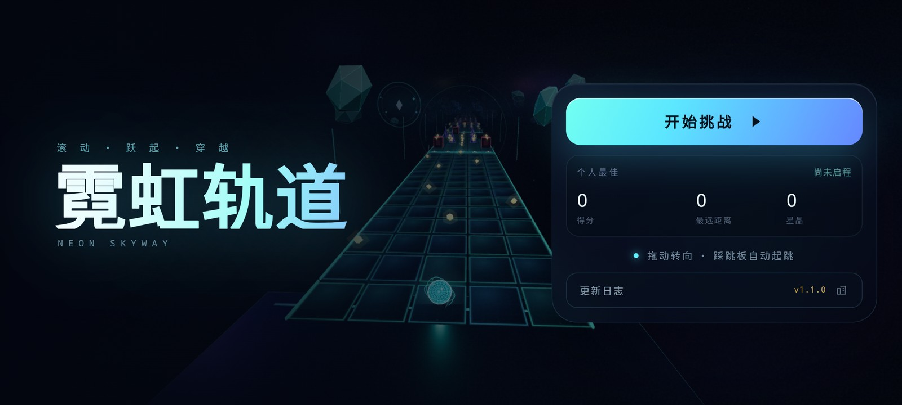

# 霓虹轨道 · Neon Skyway

一个受《滚动的天空》启发的 3D 霓虹滚球跑酷游戏。纯原生 HTML / CSS / JavaScript，搭配本地 Three.js，无需安装依赖、无需构建。



## 开始游戏

**推荐：** 双击 `start.command`，它会在本地启动服务并打开浏览器（macOS）。

手动运行：

```bash
cd rolling-sky-plus
python3 -m http.server 8123 --bind 127.0.0.1
```

然后打开 <http://127.0.0.1:8123/>。也可以直接双击 `index.html` 离线游玩。

## 操作

| 操作 | 键盘 | 触屏 |
| --- | --- | --- |
| 左右转向 | `A` / `D` 或 `←` / `→` | 按住并左右拖动 |
| 起跳 | 踩上发光跳板自动起跳 | 踩上发光跳板自动起跳 |
| 暂停 | `Esc` / `P` | 右上角暂停按钮 |
| 静音 | 右上角声音按钮 | 右上角声音按钮 |

> v1.1.0 起移除手动跳跃：跳板是唯一的起跳源。每次腾空都与 120 BPM 音乐重拍同步。

## 玩法

- 滚球自动向前，穿过 **1200 米** 的霓虹轨道，抵达终点拱门。
- 共 **3 颗星核**。撞上障碍或坠出轨道会损失 1 颗，并短暂无敌。
- 每 **300 / 600 / 900 米** 设有检查点：坠落后回到最近检查点，生命恢复至 3 颗。
- 收集金色**星晶**加分；跳板后的空中星晶弧是主要得分路线。
- 发光**宽跳板**会自动把球弹起，越过随后的低墙或缺口；在跳板前选好车道。
- 沿途有移动障碍、断桥、窄道和需要连续变道的节拍段。
- 整条轨道分为 6 个主题区域（晨曦回廊 → 天穹之门），每个区域都有新的地标与障碍。
- 最高分、最远距离和星晶总数会保存在浏览器本地。
- 首次打开或升级后会展示更新日志，之后可从主菜单再次打开。

## 特性

- 确定性的 120 BPM 节奏关卡，25 块宽跳板按拍布置。
- 旋转棱镜、镜面板、陨石、光环、漂移平台五种新障碍。
- 六区签名场景：晨曦光环、裂谷碑阵、赤霞涡轮、镜面拱廊、陨石群、天穹钟摆。
- 完整的开始菜单、倒计时、暂停、结算、更新日志与重开流程。
- WebAudio 实时合成的原创电音与音效，无外部音频文件；踩板触发 impact，提前一拍 riser。
- 球体、拖尾、护盾、冲击波、粒子、星场、远景晶体等全部实时渲染。
- 键盘、鼠标拖拽、触屏三种输入；桌面横屏、移动横屏与竖屏布局均已适配。

## 文件结构

```text
rolling-sky-plus/
├── index.html          # 页面与界面结构
├── css/style.css       # 霓虹视觉、HUD、菜单、更新日志、移动端适配
├── js/game.js          # 游戏主逻辑、渲染、节奏关卡、WebAudio
├── vendor/three.min.js # Three.js r152（MIT，本地加载）
├── preview/            # 截图
├── start.command       # 一键本地启动（macOS）
├── CHANGELOG.md
└── README.md
```

## 说明

- Three.js 以 UMD 方式加载，控制台会出现一条 r150+ 的弃用提示，不影响运行。
- 浏览器需要支持 WebGL；若初始化失败，页面会显示提示而不是黑屏。
- 游戏不依赖网络，所有资源均在本地。
